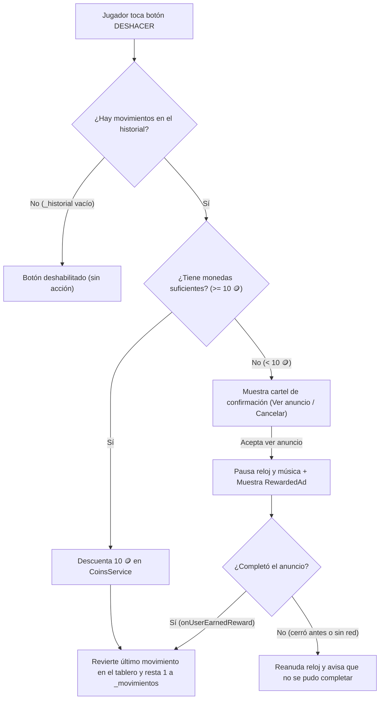

# Plan de Implementación: Sistema de Monedas, Deshacer Movimiento y Anuncios Bonificados (Rewarded Ads)

> **Estado:** Aprobado y listo para implementar en la rama `feat/monedas-y-deshacer`.

---

## 1. Decisiones de Diseño Confirmadas

1. **Economía de Monedas:**
   - **Saldo inicial de bienvenida:** `20 🪙` (otorgado una única vez al instalar/iniciar por primera vez; equivale a 2 usos gratuitos de Deshacer).
   - **Costo de Deshacer 1 movimiento:** `10 🪙`.
   - **Recompensas al ganar partida:**
     - **Modo Clásico:** `3×3` = `+10 🪙` | `4×4` = `+20 🪙` | `5×5` = `+30 🪙`.
     - **Modo Desafío (niveles 1 a 20):** `1 ⭐` = `+10 🪙` | `2 ⭐` = `+20 🪙` | `3 ⭐` = `+30 🪙`.
     - **Desafío Diario:** `+25 🪙`.
2. **Modos Habilitados:**
   - El botón **Deshacer** estará disponible en **todos los modos de juego** (Modo Clásico 3×3/4×4/5×5, Modo Desafío por Niveles y Desafío Diario).
3. **Flujo cuando no hay monedas suficientes (`< 10 🪙`):**
   - Al tocar el botón **Deshacer**, se mostrará primero un **cartel de confirmación** indicando que no alcanza el saldo de monedas y preguntando si desea ver un anuncio corto (*Rewarded Ad*) para deshacer el movimiento gratis.

---

## 2. Flujo de Funcionamiento



---

## 3. Cambios Propuestos por Componente

### 3.1. Servicio de Monedas
#### [NEW] `lib/services/coins_service.dart`
- Administra el saldo de monedas en `SharedPreferences` (`monedas_saldo` y `monedas_bienvenida_entregada`).
- Expone `static final ValueNotifier<int> saldoListenable = ValueNotifier<int>(0)`.
- Constantes:
  - `bienvenida = 20`
  - `costoDeshacer = 10`
  - `recompensaDiario = 25`
- Métodos:
  - `inicializar()`: carga el saldo al arrancar la app en `main.dart` (y otorga las `20 🪙` iniciales si `monedas_bienvenida_entregada` es `false`).
  - `recompensaClasico(int size)`: devuelve `10` (3×3), `20` (4×4) o `30` (5×5).
  - `recompensaDesafio(int estrellas)`: devuelve `10` (1⭐), `20` (2⭐) o `30` (3⭐).
  - `agregarMonedas(int cantidad)`: suma monedas al ganar un nivel y persiste en disco.
  - `gastarMonedas(int costo)`: verifica si `saldo >= costo`, descuenta y devuelve `true` (o `false` si no alcanza).

---

### 3.2. Anuncios Bonificados (Rewarded Ads) en AdMob
#### [MODIFY] `lib/services/admob_service.dart`
- Agregar soporte para `RewardedAd`:
  - Variables de entorno opcionales `ADMOB_REWARDED_ANDROID` y `ADMOB_REWARDED_IOS` en `dart_defines.json`, con fallback automático a los **Test IDs oficiales de Google** (`ca-app-pub-3940256099942544/5224354917` en Android y `ca-app-pub-3940256099942544/1712485313` en iOS) en debug o si no se configuró un ID de producción.
  - `loadRewarded()`: precarga un `RewardedAd` al inicializar el SDK y vuelve a precargar automáticamente luego de usarse.
  - `Future<bool> mostrarRewardedParaDeshacer()`: pausa la música, muestra el anuncio bonificado, espera el callback `onUserEarnedReward` y devuelve `true` únicamente si el usuario completó la visualización de la publicidad.
  - `@visibleForTesting static Future<bool> Function()? mostrarRewardedOverride` para pruebas deterministas en tests de widgets.

---

### 3.3. Lógica de Historial, Autoguardado y Pantalla de Juego
#### [MODIFY] `lib/services/saved_game_service.dart`
- Agregar campo opcional `List<int> historialHuecos` en `PartidaGuardada` (retrocompatible si no existe en un JSON previo) para conservar la pila de movimientos al pausar o salir de la partida.

#### [MODIFY] `lib/screens/game_screen.dart`
- Agregar `final List<int> _historialHuecos = <int>[]` y `final ValueNotifier<bool> _puedeDeshacer = ValueNotifier<bool>(false)`.
- En `_onTapFicha(int indice)`:
  - Antes de aplicar `PuzzleLogic.mover`, guardar `_historialHuecos.add(_tablero.value.indexOf(0))` y actualizar `_puedeDeshacer.value = true`.
- En `_reiniciar()`:
  - Limpiar `_historialHuecos.clear()` y `_puedeDeshacer.value = false`.
- Nuevo método `Future<void> _onDeshacer()`:
  - Verifica que `!_pausado && !_juegoTerminado && _historialHuecos.isNotEmpty`.
  - Si `CoinsService.gastarMonedas(CoinsService.costoDeshacer)` es `true`, ejecuta `_aplicarDeshacer()`.
  - Si no tiene monedas suficientes (`< 10 🪙`):
    1. Pausa preventivamente el cronómetro (`_detenerTimer()`).
    2. Muestra un diálogo de confirmación explicando que no tiene las `10 🪙` necesarias y ofreciendo **Ver anuncio** para deshacer gratis o **Cancelar**.
    3. Si acepta, invoca `AdMobService.mostrarRewardedParaDeshacer()`.
    4. Al cerrar el diálogo/anuncio, reanuda el cronómetro si la partida seguía activa (`!_pausado && !_juegoTerminado && _juegoIniciado`) y, si obtuvo la recompensa, ejecuta `_aplicarDeshacer()`.
- En `_mostrarVictoria()`, `_mostrarVictoriaDesafio()` y `_mostrarVictoriaDiario()`:
  - Otorgar las monedas ganadas mediante `CoinsService.agregarMonedas(...)` y mostrar una fila `+XX 🪙` en el diálogo de victoria (`GameScreen` y `DailyVictoryDialog`).

---

### 3.4. Interfaz de Usuario e Internacionalización
#### [MODIFY] `lib/widgets/game_controls.dart`
- Incorporar el botón central **Deshacer** en la botonera inferior junto a **Reiniciar** y **Pausar**:
  - Muestra el ícono `Icons.undo_rounded` junto al costo (`10`) cuando el jugador tiene saldo suficiente, o el ícono de video (`Icons.smart_display_rounded`) cuando tiene `< 10 🪙`.
  - Se deshabilita visualmente cuando `puedeDeshacer` es `false` o el juego está en pausa.

#### [MODIFY] `lib/widgets/game_header.dart` y `lib/widgets/home_header.dart`
- Mostrar una píldora compacta con el saldo actual de monedas (`🪙 XX`) escuchando a `CoinsService.saldoListenable`.

#### [MODIFY] `lib/l10n/app_es.arb` y `lib/l10n/app_en.arb`
- Agregar las claves de traducción para el botón de deshacer, monedas ganadas en el modal de victoria y el cartel de confirmación para ver anuncio bonificado.

---

## 4. Plan de Verificación

1. **`test/coins_service_test.dart` (Nuevo):**
   - Verificar entrega de saldo inicial de bienvenida (`20 🪙` una única vez).
   - Verificar suma de monedas al ganar partidas (Clásico, Desafío, Diario) y descuento al deshacer.
   - Verificar que `gastarMonedas` devuelve `false` y no deja saldo negativo cuando no alcanza.
2. **`test/undo_move_test.dart` (Nuevo):**
   - Verificar en `GameScreen` que tras mover fichas y tocar **Deshacer**, el tablero regresa exactamente a la posición anterior y el contador de movimientos disminuye en `1`.
   - Verificar el cartel de confirmación sin monedas y la ejecución del deshacer tras simular `mostrarRewardedOverride = () async => true`.
3. **Suite completa y análisis estático:**
   ```powershell
   flutter analyze
   flutter test
   ```

